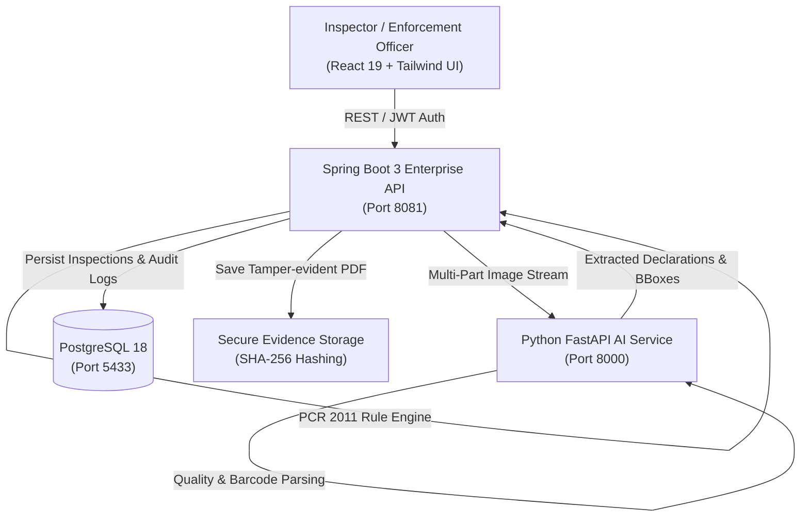

# PackSure 📦🔍
### Automated Legal Metrology & Product Compliance Inspection Platform

[](https://spring.io/projects/spring-boot)
[](https://fastapi.tiangolo.com/)
[](https://react.dev/)
[](https://opencv.org/)
[](https://www.postgresql.org/)
[](LICENSE)

**PackSure** is an end-to-end, AI-powered regulatory enforcement and packaging inspection platform designed to automate physical compliance audits under the **Legal Metrology (Packaged Commodities) Rules, 2011** and the **Legal Metrology Act, 2009**.

By uniting high-throughput Computer Vision, Deep Learning OCR, deterministic rule evaluation, and a Human-in-the-Loop (HITL) review dashboard, PackSure slashes physical inspection times by up to **80%** while generating court-admissible, digitally verifiable audit reports.

---

## 🏛️ System Architecture

PackSure is engineered around an enterprise microservices architecture:



### 1. **React 19 + Vite Frontend Application** (`Port 5173`)
- **Interactive 3-Panel Inspection Interface**: Synchronized package photo viewer with dynamic SVG bounding-box overlays, extracted declaration cards with AI confidence gauges, and regulatory rule evaluation panels.
- **Human-in-the-Loop (HITL) Overrides**: Inline field verification and editing with real-time recalculation of compliance scoring.
- **Analytics & Trends**: Recharts-powered analytics for compliance distribution, regional inspection activity, and violation severity metrics.

### 2. **Spring Boot 3 Enterprise Backend** (`Port 8081`)
- **Statutory Rule Engine**: Configurable compliance evaluation engine enforcing PCR 2011 rules (MRP declarations, net weight/volume formatting, date of manufacture/packing, customer helpline, manufacturer/packer details, FSSAI numbers).
- **Cryptographic PDF Reporting**: Generates court-ready legal inspection certificates via OpenPDF, sealed with tamper-evident **SHA-256 cryptographic hashes**.
- **Historical Batch Change Detection**: Automatic regression tracking against registered barcodes to flag unauthorized labeling changes across manufacturing batches.
- **Enterprise Security**: Spring Security 6 with stateless JWT authentication, Role-Based Access Control (`OFFICER` vs `ADMIN`), and immutable audit logging.

### 3. **Python FastAPI AI & Computer Vision Microservice** (`Port 8000`)
- **Image Quality Scoring**: Pre-assessment scoring for blur (Laplacian variance), glare/specular highlights, and pixel density.
- **Deep Learning OCR**: High-accuracy text detection and recognition using **RapidOCR (PaddleOCR PP-OCRv4 ONNX)**.
- **1D/2D Barcode Scanning**: Sub-millisecond barcode decoding via **pyzbar** (EAN-13, UPC, Code 128, DataMatrix, QR).
- **Contextual NLP & Normalization**: Regex and rule-based normalizers for Indian Rupee formats (`₹`, `Rs.`), unit conversions, and date pattern matching.
- **Multi-Signal Classification**: Heuristic and Bayesian classification to categorize products into statutory categories (Food, Pharmaceuticals, Cosmetics, Electronics, Textiles, Household).

### 4. **PostgreSQL Database** (`Port 5433`)
- Normalized relational schema managing products, inspections, multi-image evidence, detected declarations, rule versions, violation notices, and tamper-evident audit logs.

---

## 🚀 Key Features

- **Multi-Panel Camera & Image Upload**: Ingest front, back, side, and label panel photos in a single inspection pass.
- **Real-Time Visual Explainability**: Pinpoint exact bounding boxes on physical package photos corresponding to extracted declarations.
- **Dual Verification Modes**: AI-assisted fast scanning with explicit enforcement officer verification and sign-off.
- **Role-Based Access Control**:
  - `Enforcement Officer`: Field inspections, declaration verification, penalty recommendation, and report generation.
  - `Administrator`: Rule configuration, category parameters, user provisioning, and systemic audit review.
- **Cryptographic Integrity**: Every inspection report has its content hashed (SHA-256) upon generation, preventing tampering or retroactive manipulation.

---

## 🛠️ Tech Stack

| Domain | Technologies |
| :--- | :--- |
| **Frontend** | React 19, Vite, Tailwind CSS, Lucide React, Recharts, Axios, Sonner |
| **Backend API** | Java 17, Spring Boot 3.3.4, Spring Data JPA, Spring Security, OpenPDF, JJWT |
| **AI / Vision** | Python 3.10+, FastAPI, OpenCV, RapidOCR (PP-OCRv4 ONNX), PyZbar, NumPy, Pydantic |
| **Database** | PostgreSQL 18 |
| **Security** | JWT (HMAC-SHA256), Spring Security RBAC, SHA-256 Report Hashes, Immutable Audit Trail |

---

## 🚦 Getting Started

### Prerequisites
- **Java 17+** (JDK)
- **Python 3.10+**
- **Node.js 18+ & npm**
- **PostgreSQL 18** (or PostgreSQL 14+)

---

### Quick 1-Click Launch (Windows)

Simply double-click `run_all.bat` (or execute `.\run_all.ps1` in PowerShell). This script spins up all 4 services and automatically launches the browser to `http://localhost:5173`.

---

### Manual Service Startup

#### 1. PostgreSQL Database
Ensure your PostgreSQL instance is running on port `5433` with database name `packsure`:
```powershell
& "D:\postgreSql\bin\postgres.exe" -D "d:\ProductCompliance\db"
```

#### 2. Python AI & Computer Vision Service
```bash
cd ai-service
pip install -r requirements.txt
python main.py
```
*Health Check: `http://127.0.0.1:8000/api/v1/health`*

#### 3. Spring Boot Backend API
```bash
cd backend
mvn spring-boot:run
```
*Health Check & Swagger: `http://localhost:8081/swagger-ui.html`*

#### 4. React Frontend
```bash
npm install
npm run dev
```
*Application URL: `http://localhost:5173`*

---

## 🔑 Default Login Credentials

| Role | Username | Password | Circle / Location |
| :--- | :--- | :--- | :--- |
| **Enforcement Officer** | `officer` | `Officer@123` | Delhi Zone Circle |
| **Administrator** | `admin` | `Admin@123` | Legal Metrology HQ |

---

## 📋 Inspection Workflow

1. **Sign In**: Log in using your assigned officer or administrator credentials.
2. **Initialize Inspection**: Click **"Start Inspection"** and enter store/retail details.
3. **Capture Package Photos**: Snap live photos using the viewfinder or upload multiple package images (front, back, nutrition/spec panel).
4. **Automated AI Scan**: RapidOCR and OpenCV pre-process images, extract declarations, and cross-reference PCR 2011 legal rules.
5. **Interactive Review**: Review highlighted bounding boxes, verify/override values, and view rule compliance scores.
6. **Issue Certificate**: Finalize inspection and export an official, court-admissible PDF stamped with an SHA-256 verification hash.

---

## 📄 License

This project is licensed under the MIT License - see the [LICENSE](LICENSE) file for details.
