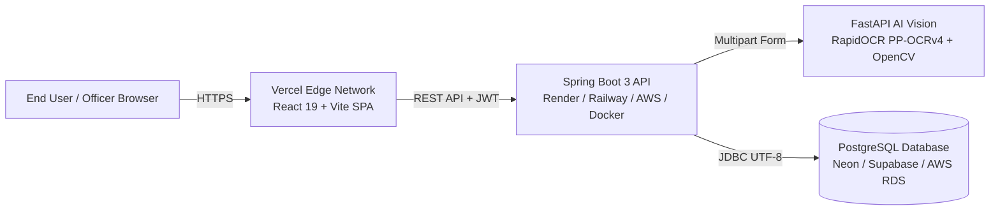

# PackSure — Vercel Deployment & Production Guide

This guide details how to deploy the **PackSure Legal Metrology Compliance Platform** to production using **Vercel** for the frontend and cloud hosting for the backend services.

---

## Architecture Overview



- **Frontend (Vercel)**: React 19, Tailwind CSS, Vite, Lucide Icons, Recharts.
- **Backend API**: Spring Boot 3, Spring Security 6 (Stateless JWT), PCR 2011 Rule Engine, OpenPDF report generator.
- **AI Microservice**: Python FastAPI, RapidOCR (PaddleOCR ONNX), pyzbar, OpenCV.
- **Database**: PostgreSQL with UTF-8 client encoding.

---

## 1. Deploying Frontend to Vercel

The repository is now pre-configured for **1-click Vercel deployment** via `vercel.json`.

### Option A: Via GitHub (Recommended)
1. Push your repository to GitHub or GitLab.
2. Go to [vercel.com](https://vercel.com) and click **"Add New Project"**.
3. Import your `product-compliance-scanner` repository.
4. Framework Preset: **Vite** (auto-detected).
5. Build Command: `npm run build` (auto-detected).
6. Output Directory: `dist` (auto-detected).
7. Under **Environment Variables**, add:
   | Key | Value | Description |
   | :--- | :--- | :--- |
   | `VITE_API_BASE_URL` | `https://your-backend-api.com/api` | Your deployed Spring Boot API URL |
8. Click **Deploy**.

### Option B: Via Vercel CLI
```bash
# Install Vercel CLI if not installed
npm install -g vercel

# Login to Vercel
vercel login

# Deploy to preview
vercel

# Deploy to production with environment variable
vercel --prod -e VITE_API_BASE_URL=https://your-backend-api.com/api
```

---

## 2. Configured Vercel Settings (`vercel.json`)

`vercel.json` is configured in the project root with industry-standard rules:
- **SPA Client-Side Routing**: All non-asset routes rewrite to `/index.html` (prevents 404 on page refresh at `/scan`, `/dashboard`, `/history`, `/inspection/:id`).
- **CDN Asset Caching**: 1-year immutable caching for static bundles (`/assets/*`).
- **Security Headers**: `X-Content-Type-Options: nosniff`, `X-Frame-Options: SAMEORIGIN`, `X-XSS-Protection: 1; mode=block`, and `Referrer-Policy: strict-origin-when-cross-origin`.
- **Code Splitting**: Vite bundle split into `vendor`, `charts`, `ui`, and `pdf` chunks for fast initial load.

---

## 3. Backend & AI Hosting Options

Because Vercel is a serverless frontend platform, the Spring Boot backend and Python AI service should be hosted on a persistent container or cloud service:

### Easy 1-Click Cloud Options:
1. **Render.com** (Free / Cheap):
   - Deploy `backend` as a **Web Service** (Java Docker or Maven).
   - Deploy `ai-service` as a **Web Service** (Python 3.10+).
   - Add a managed **PostgreSQL** instance.
2. **Railway.app**:
   - One-click deploy PostgreSQL, Spring Boot, and FastAPI in a single project.
3. **AWS / Google Cloud / DigitalOcean / Docker**:
   - Use containerized deployment.

### Backend Environment Variables:
| Variable | Example Value | Description |
| :--- | :--- | :--- |
| `PORT` | `8081` or `$PORT` | Server listening port |
| `SPRING_DATASOURCE_URL` | `jdbc:postgresql://host:5432/packsure?clientEncoding=UTF8` | Database connection string |
| `SPRING_DATASOURCE_USERNAME` | `postgres` | Database username |
| `SPRING_DATASOURCE_PASSWORD` | `your_secret_password` | Database password |
| `PACKSURE_AI_SERVICE_URL` | `https://ai.yourdomain.com` | Python FastAPI AI service URL |
| `PACKSURE_CORS_ALLOWED_ORIGINS` | `https://*.vercel.app,https://yourdomain.com` | Allowed CORS origins for Vercel |
| `PACKSURE_JWT_SECRET` | `404E635266556A586E3272357538782F413F4428472B4B6250645367566B5970` | 256-bit signing secret |
| `PACKSURE_STORAGE_PATH` | `./storage` | Filesystem path for images and reports |

---

## 4. Production Checklist & Health Check

1. **Verify Backend Health**:
   ```bash
   curl -X GET https://your-backend-api.com/api/health
   ```
   Returns `{"database":"CONNECTED","aiService":"AVAILABLE","storage":"AVAILABLE"}`.

2. **Verify AI Service Health**:
   ```bash
   curl -X GET https://your-ai-service.com/api/v1/health
   ```
   Returns `{"status":"UP","ocrEngine":"RapidOCR (PaddleOCR ONNX)"}`.

3. **Verify Vercel Web App**:
   Visit your Vercel URL (`https://your-project.vercel.app`), sign in with officer credentials (`officer` / `Officer@123`), and run a package scan.
